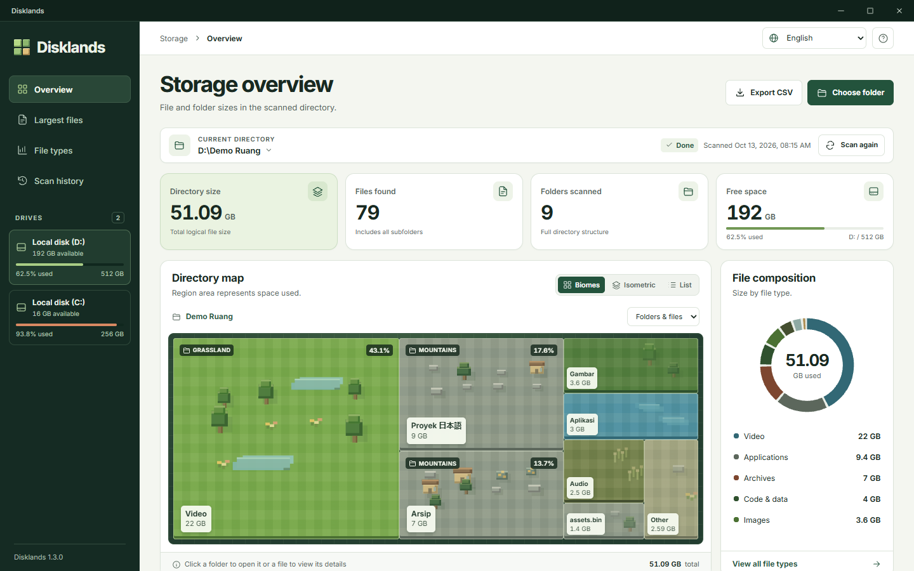

# Disklands

Disklands is a Windows desktop app for exploring where storage space goes. Scan a folder or drive, then inspect file and folder sizes through a biome map, an isometric view, and searchable lists. Scanning uses local file metadata and never opens file contents for analysis.

**Windows x64 · Portable · English and Bahasa Indonesia**

[Download Disklands v1.3.0](https://github.com/mdaninas/disklands/releases/download/v1.3.0/Disklands-1.3.0-Windows.exe)



*Dashboard shown with sample data.*

## Get started

1. Download and run the portable EXE. It requires no installation or Node.js.
2. Select **Choose folder**, or select a drive in the sidebar to scan the entire drive.
3. Open a folder on the map to explore it. Use the breadcrumb or **Parent folder** to return.
4. Use **Largest files** and **File types** to investigate space usage. Select an item to inspect its size, path, and modification time.

You can show a selected item in Windows Explorer, copy its path, or export the scan summary as CSV. **Stop** cancels an active scan and retains the previous completed result, if one exists.

In a source checkout, `Open Disklands.cmd` launches the local portable build when available. After installing dependencies, it can also start Electron with the built interface.

## Features

- **Explore visually.** Switch between biome, isometric, and list views. Map regions are proportional to file or folder size.
- **Find large files.** Search the 500 largest files in a scan, filter by file type or minimum size, and sort by size, name, or modification time.
- **Understand file types.** Review storage by extension and open a category to see its largest files.
- **Inspect and export.** View file size, location, modification time, and folder contents. Open locations in Explorer, copy paths, and export the summary, file categories, and largest files to CSV.
- **Return to earlier scans.** Disklands saves the latest 30 completed scan summaries. Select **Scan again** to refresh and explore a previous location.
- **Choose a language.** English is the default. Switch between English and Bahasa Indonesia from the top toolbar. The choice persists between launches and also applies to the folder picker, export dialog, and CSV headings. The app name remains Disklands in both languages.

## Understand the results

Disklands reports **logical file size** in units of 1,024 bytes. This can differ from **Size on disk** in Windows Explorer because of compression, sparse files, cloud files, or hard links. Hard links may be counted more than once. The folder count excludes the selected root. Drive capacity applies to the whole drive, while directory size applies only to the selected folder.

The directory map shows up to 11 primary regions, each representing at least 1.8% of the displayed total. Smaller items are grouped into **Other**. Open **Other** to view the directory list and search. **Folders only** restricts the map to subfolders. Empty folders remain in the directory list, but have no map region because their size is zero. Scenery is decorative and does not represent file count or capacity. Folder biomes stay consistent for a path, while file biomes follow file type.

| Area | Scope |
| --- | --- |
| Folder index | All subfolders and up to 30 largest files directly inside each folder |
| Directory contents | Up to 150 indexed items after search and sorting |
| Map list | Up to 30 items from the current folder index |
| Largest files | Up to 500 files from the complete scan |

Files omitted from the folder index still contribute to total size and file count. Search in **Directory contents** uses that index. Search and filters in **Largest files** use the top 500 files. CSV export includes the summary, categories, and top files, rather than every scanned file.

Hidden files are included. Symbolic links and junctions are skipped. Disklands reports unreadable locations and includes only readable items in its totals. Files that change during a scan can also affect the result.

## Privacy and saved data

Disklands reads file names, paths, sizes, and modification times locally. It does not upload, move, or delete files. File management takes place in Windows Explorer.

Scan history, the last selected folder, and the language preference are stored in `history.json` under the Electron user data directory. The folder index remains in memory and is available after a completed scan. On first launch, Disklands can import existing Ruang history. History entries contain summaries, so select **Scan again** to rebuild a folder index for an earlier location.

## Keyboard shortcuts

| Shortcut | Action |
| --- | --- |
| `Ctrl+O` | Choose a folder when no scan is running |
| `Ctrl+F` | Focus search on the current page, when available |
| `Esc` | Close item details or the guide |

## Build from source

Use Node.js 22.12 or newer and npm on Windows. Dependency installation requires an internet connection.

```powershell
npm ci
npm run dev
```

The development command starts Vite at `http://127.0.0.1:5173` and opens Electron. Port 5173 must be available. A browser can display the interface, while local file access requires the Electron app.

To scan a specific folder at startup:

```powershell
npm run dev -- --scan="D:\Folder Example"
```

| Command | Purpose |
| --- | --- |
| `npm run dev` | Start Vite and Electron for development |
| `npm test` | Run scanner and biome tests |
| `npm run build` | Build the renderer in `dist/` |
| `npm start` | Open Electron with the built renderer |
| `npm run package` | Build the renderer and a portable Windows x64 EXE |

`npm run package` writes `release/v1.3.0/Disklands-1.3.0-Windows.exe` and copies it to `release/Disklands-1.3.0-Windows.exe`. The version comes from `package.json`. Build output under `release/` is ignored by Git and distributed through [GitHub Releases](https://github.com/mdaninas/disklands/releases).

## Project structure

| Path | Responsibility |
| --- | --- |
| `electron/main.cjs` | Window lifecycle, desktop actions, drives, history, language, and CSV export |
| `electron/preload.cjs` | Desktop API exposed to the renderer |
| `electron/scanner.cjs` | Metadata scanning in a worker thread |
| `src/main.js` | Interface, navigation, and scan state |
| `src/i18n.js` | English UI translations |
| `src/biomes.js` | Biome assignment and scenery |
| `src/style.css`, `src/biome-theme.css` | Interface and map styling |
| `scripts/package.cjs` | Portable Windows build |
| `tests/` | Scanner and biome tests |

The interface uses JavaScript, Vite, and a bundled Inter font. Electron provides desktop access through a preload API with context isolation.
